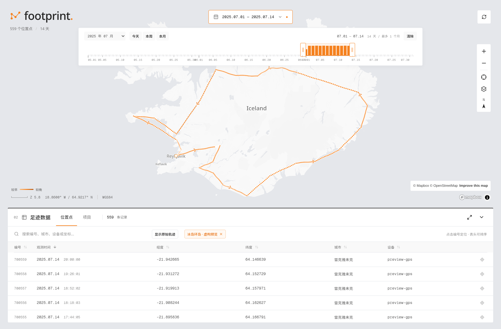

# Footprint Serverless



*预览使用独立生成的虚构轨迹数据。*

基于 Cloudflare Workers 和 D1 的个人足迹记录与可视化应用，包含位置上报 API 和地图控制台，支持自行部署。

## 功能

- **足迹地图**：浏览位置点，按时间顺序绘制轨迹，结合地图聚合和虚拟表格查看数据。
- **时间轴**：选择日期范围，快速查看今天、本周、本月，以及指定点前后各 24 小时的轨迹。
- **项目管理**：以时间范围组织行程，支持新增、编辑和地图预览。
- **偏离点检测**：上报时执行局部分析，独立保存质量标记；控制台默认隐藏疑似异常点，可切换查看原始轨迹。
- **当地时间**：保存客户端上报的 UTC 偏移，在位置详情中显示观测时刻的当地时间。
- **独立鉴权**：API 使用 Bearer Token；生产控制台通过 Cloudflare Access 登录。

## 架构

| 服务 | 职责 | 技术与存储 |
| --- | --- | --- |
| API Worker | 位置上报、轨迹查询、项目读写与质量标记 | Cloudflare Workers、D1 |
| Console Worker | 提供前端资源、校验 Access JWT、代理控制台请求 | Workers Static Assets、Service Binding |
| 地图控制台 | 地图交互、时间轴与数据表格 | React、Mapbox GL JS、TanStack Table / Virtual |

客户端直接调用 API Worker。浏览器访问 Console Worker，由 Console 在服务端携带 Token，通过 Service Binding 调用 API；API Token 不发送到浏览器。

## 本地运行

需要 **Node.js 24+** 和 **pnpm 11.28.5**。Wrangler 已作为项目依赖安装。

### 1. 安装与配置

在仓库根目录执行以下命令。已有配置文件时，保留自己的配置。

```bash
pnpm --dir worker install --frozen-lockfile
cp worker/api/.dev.vars.example worker/api/.dev.vars
cp worker/console/.dev.vars.example worker/console/.dev.vars
```

在 `worker/console/.dev.vars` 中填写 Mapbox 公开 Token：

```dotenv
MAPBOX_PUBLIC_TOKEN="pk.…"
MAPBOX_STYLE="mapbox://styles/mapbox/light-v11"
```

API 的本地 Token 位于 `worker/api/.dev.vars`。控制台开发服务器会读取它，并在代理请求时添加鉴权头。

### 2. 启动 API

```bash
pnpm --dir worker run db:migrate
pnpm --dir worker run dev:api
```

默认地址：`http://localhost:8787`。

### 3. 启动控制台

在另一个终端执行：

```bash
pnpm --dir worker run dev:console
```

打开 `http://127.0.0.1:5173`。本地预览不要求 Cloudflare Access，数据来自本地 D1；首次启动时数据库为空。

## 接入位置上报

向 `PUT /api/location` 发送位置，并在请求头中携带 API Token。以下示例使用本地开发配置：

```bash
export FOOTPRINT_TOKEN='local-development-only-change-me'

curl -X PUT http://localhost:8787/api/location \
  -H "Authorization: Bearer $FOOTPRINT_TOKEN" \
  -H 'Content-Type: application/json' \
  -d '{"longitude":0,"latitude":0,"datetime":"2024-01-01T00:00:00Z","timezone":0,"device":"example-device"}'
```

坐标采用 WGS84。时间使用 Unix 毫秒时间戳或带时区的 ISO 8601 字符串；`timezone` 表示观测时刻的 UTC 小时偏移，例如 `8`、`-5`、`5.5`。客户端可通过 `-new Date(timestamp).getTimezoneOffset() / 60` 计算偏移。

查询轨迹使用 `GET /api/locations`。完整字段、分页、项目接口及旧版兼容接口见 [API 参考](docs/api.md)。

## 部署到 Cloudflare

API 和 Console 使用两个独立 Worker，并分别连接 Workers Builds。两个 Builder 的根目录均为 `worker`，生产分支为 `main`。

| Worker | Build command | Deploy command |
| --- | --- | --- |
| `footprint-serverless-api` | `pnpm run cf:render:api && pnpm run typecheck` | `pnpm run cf:deploy:api` |
| `footprint-serverless-console` | `pnpm run cf:render:console && pnpm run typecheck && pnpm run build:console` | `pnpm run cf:deploy:console` |

API 需要名为 `DB` 的 D1 绑定；Console 需要名为 `API` 的 Service Binding，指向 API Worker。两个 Worker 使用相同的运行时 Secret `INGEST_TOKEN`。Console 另需 `ACCESS_TEAM_DOMAIN`、`ACCESS_AUD` 和 `MAPBOX_PUBLIC_TOKEN`。

部署脚本复用 API Worker 已有的 `DB` 绑定，无需在 Builder 重复填写数据库 ID。先完成首次部署，再启用 Git 自动构建。数据库初始化、Access、自定义域名和构建变量配置见 [部署指南](docs/deployment.md)。

## 开发与验证

```bash
# 类型检查、本地迁移和测试
pnpm --dir worker run check

# 构建前端静态资源
pnpm --dir worker run build:console

# 检查 API Worker 构建，不发布
pnpm --dir worker run build:api
```

项目结构：

```text
worker/api/          API、D1 迁移与集成测试
worker/console/      地图前端、Console Worker 与测试
worker/scripts/      Wrangler 配置与部署脚本
scripts/trajectory/  离线轨迹分析和时区回填工具
docs/                API、部署与算法文档
```

## 文档

- [API 参考](docs/api.md)：位置上报、查询筛选、项目读写、错误响应与兼容接口。
- [部署指南](docs/deployment.md)：首次部署、两个 Workers Builds、鉴权与自定义域名。
- [开发指南](docs/development.md)：本地数据、浏览器验证和离线处理。
- [轨迹偏离点检测](docs/trajectory-outliers.md)：算法依据、实时窗口、离线分析与 D1 读写预算。

轨迹分析只保存独立标记，不修改原始坐标。仓库提供通用配置模板；实际部署信息、凭据和轨迹数据由部署者自行管理。
